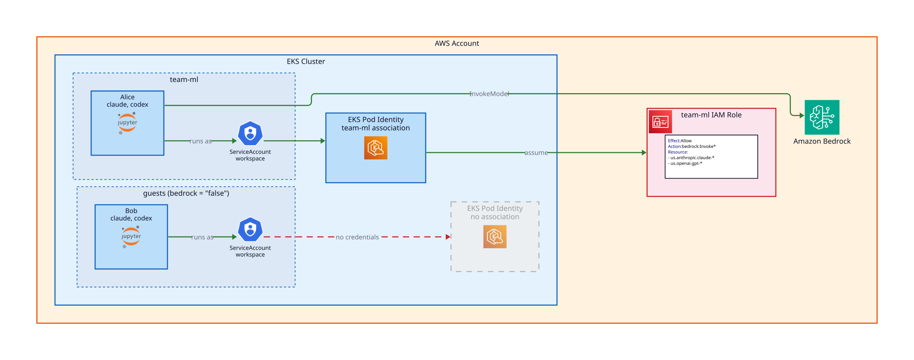

# Bedrock Integration

The **JupyterLab** workspace image ships the **Claude Code** (`claude`) and **Codex** (`codex`)
coding agents. With `workspace_bedrock_enabled` set to `true` (the default), workspaces get AWS
credentials limited to invoking Amazon Bedrock models, so both agents work in a workspace
terminal with no setup.

Each workspace runs as the `workspace` service account of its namespace. **EKS Pod Identity**
binds that service account to an IAM role dedicated to the namespace. The role may only invoke
the allowed models.



## Enable the models in your account

Bedrock enables a third-party model (Anthropic Claude, OpenAI GPT) on its first invocation in an
AWS account, by subscribing the account through AWS Marketplace. This is a one-time operation
in your AWS account.

```{warning}
The workspace roles hold no AWS Marketplace permissions, so an admin must make that first call for each model.
A workspace call fails with `AccessDeniedException` until then.
```

Invoking a third-party model accepts the provider's EULA: review the terms first. Then, with a
principal allowed to subscribe through AWS Marketplace, in the deployment's region:

1. **Anthropic only**: submit the first-time-use form. Open any Anthropic model in the
   Bedrock console model catalog and submit your use case details. You submit it once per
   AWS Organization.
2. **Each model**: open the model in the Bedrock console playground and send one prompt.
3. **Wait**: the agreement can take up to 15 minutes to become available.

The project's `TROUBLESHOOT.md` lists the equivalent AWS CLI commands.

## Choose the inference scope

The agents call Bedrock in the deployment region through cross-region inference profiles.
`workspace_bedrock_inference_scope` selects which ones:

| Scope | Profiles | Where Bedrock serves requests |
|---|---|---|
| `geo` (default) | the region's geography, e.g. `us.` in `us-west-2` | within that geography |
| `global` | `global.` | any commercial region |

Bedrock offers the OpenAI models through `us.` and `global.` profiles only. Outside the US,
**Codex** needs `global`.

## Choose the models

`workspace_bedrock_model_patterns` lists the Bedrock model IDs workspaces may invoke, as IAM
wildcards without the inference profile prefix. The default allows both agents:

```yaml
overrides:
  workspace_bedrock_model_patterns:
    - anthropic.claude-*
    - openai.gpt-*
```

Each agent picks its default model per release: **Claude Code**'s default must stay within the
patterns, and **Codex** uses the best model its release offers among the allowed ones.

## Pin the agent versions

`workspace_app_claude_code_version` and `workspace_app_codex_version` pin the agents installed
in the workspace image. Changing either one rebuilds the image on the next `jd up`. Workspaces
pick up the new build on their next start once you also increment
`workspace_app_jupyterlab_image_build`.

## Opt a namespace out

To withhold Bedrock from a team, set `bedrock` to `"false"` on its `workspace_namespaces` entry
(see [Team Isolation](team-isolation.md)). The namespace gets no IAM role, and its workspaces get
no AWS credentials. Set `workspace_bedrock_enabled` to `false` to withhold Bedrock from every namespace.

```yaml
overrides:
  workspace_namespaces:
    - name: team-ml
      teams: my-org:ml
    - name: guests
      teams: my-org:guests
      bedrock: "false"
```
