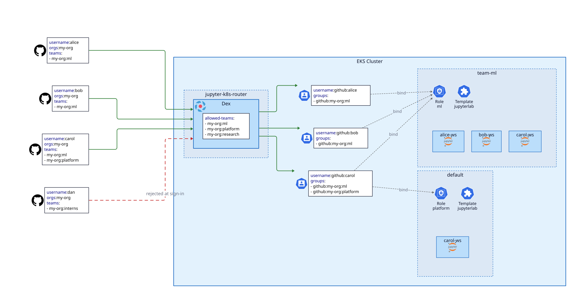

# Team Isolation

The template controls access via GitHub teams. Two variables decide who gets in and in which
Kubernetes namespace they can run workspaces:

- `oauth_allowed_teams`: the GitHub teams that may sign in, each in `org:team` format.
- `workspace_namespaces`: the Kubernetes namespaces where workspaces run.

**Dex** rejects any users who does not belong to one of the teams listed in `oauth_allowed_teams`.



## Single namespace

Leave `workspace_namespaces` empty (the default) to run every workspace in the `default` namespace.
Every team in `oauth_allowed_teams` may then create workspaces there.

```bash
# pass each team as a separate flag
jd config --oauth-allowed-teams my-org:ml --oauth-allowed-teams my-org:platform
jd up
```

## Multiple namespaces

To isolate teams from each other, list one entry per namespace in the `overrides:` block
of `variables.yaml`, then run `jd config` and `jd up`:

```yaml
overrides:
  oauth_allowed_teams:
    - my-org:ml
    - my-org:platform
  workspace_namespaces:
    - name: team-ml
      teams: my-org:ml
      templates: jupyterlab-gpu
    - name: default
      teams: my-org:ml,my-org:platform
```

Users may create, manage and access workspaces in all the namespaces associated with their GitHub team.

A user in several teams, such as Carol in the diagram above, may work in all the associated namespaces.

| Key | Required | Value |
|---|---|---|
| `name` | yes | Kubernetes namespace; must not start with `kube-` or `jupyter-k8s-`, nor name a namespace a platform component uses |
| `teams` | yes | Comma-separated GitHub teams in `org:team` format |
| `templates` | no | Comma-separated `workspace_templates` configs offered in the namespace, on top of the built-in `jupyterlab` template |
| `bedrock` | no | `"false"` to withhold Bedrock credentials from the namespace; see [Bedrock Integration](bedrock-integration.md) |

A few rules apply:

- **No namespace grants every team**: once you list namespaces, `default` admits only the teams
  of its own entry. List `default` explicitly to keep using it.
- **The first entry is the default namespace**: the Web UI and the `jd server` commands use
  it when you pass no `--scope`.
- **Each namespace offers its own templates**: a namespace offers the built-in `jupyterlab`
  template, plus the configs listed in its `templates` key. Each config must be offered by a
  `workspace_nodepools` entry.
- **Every team can read the shared namespace**: every team in `oauth_allowed_teams` gets read-only
  access to the `jupyter-k8s-shared` namespace, which holds the shared `WorkspaceTemplate` resources.

## A team must be in both lists

A team needs both variables: `oauth_allowed_teams` lets its members authenticate with **Dex**, and
access the **Web UI**.

Afterward, a `workspace_namespaces` entry grants permission to work in a particular Kubernetes namespace.
- `jd config` refuses a namespace team that is missing from `oauth_allowed_teams`: no login can
  ever carry it.
- `jd config` warns about an allowed team that no namespace lists: its members can sign in, but
  cannot create workspaces.

Admins listed in `admin_role_names` or `admin_user_names` may manage workspaces in every namespace,
regardless of team membership.

## Apply a team change

After `jd up` allowlists a new team, restart **Dex** so that it serves the new allowlist:

```bash
jd component restart --name dex
```

Users then sign in again. A token they already hold keeps their previous teams until it expires.

## Remove a namespace or a team

Removing or renaming a namespace entry deletes the namespace, with every workspace and volume
in it. To prevent accidental data loss, `jd config` refuses:
- removing a namespace that still holds a workspace: delete the workspaces first, or keep the entry;
- removing more than 5 namespaces in one change, so that it checks each one for live workspaces;
- removing a template that a live workspace still uses.

```{warning}
Removing a team from a namespace that holds workspaces only warns: the workspaces stay,
but their owners in that team lose access to them.
```